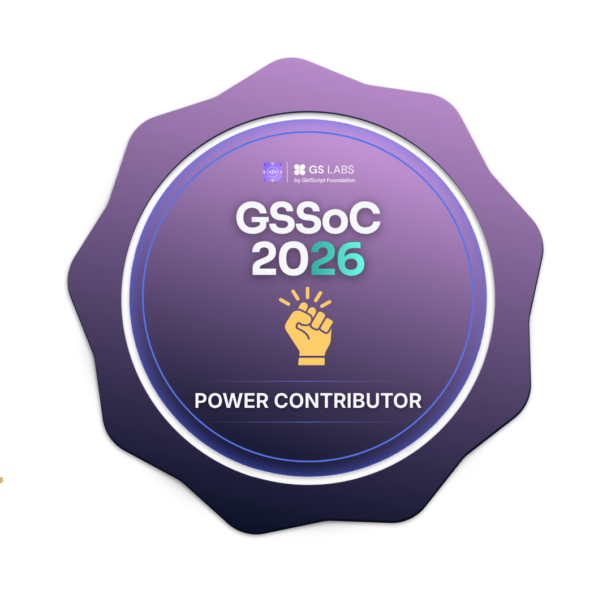
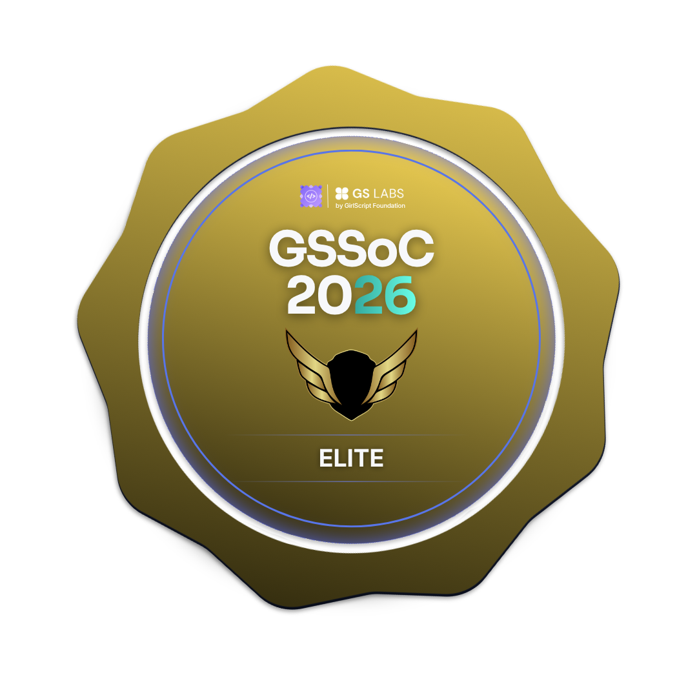
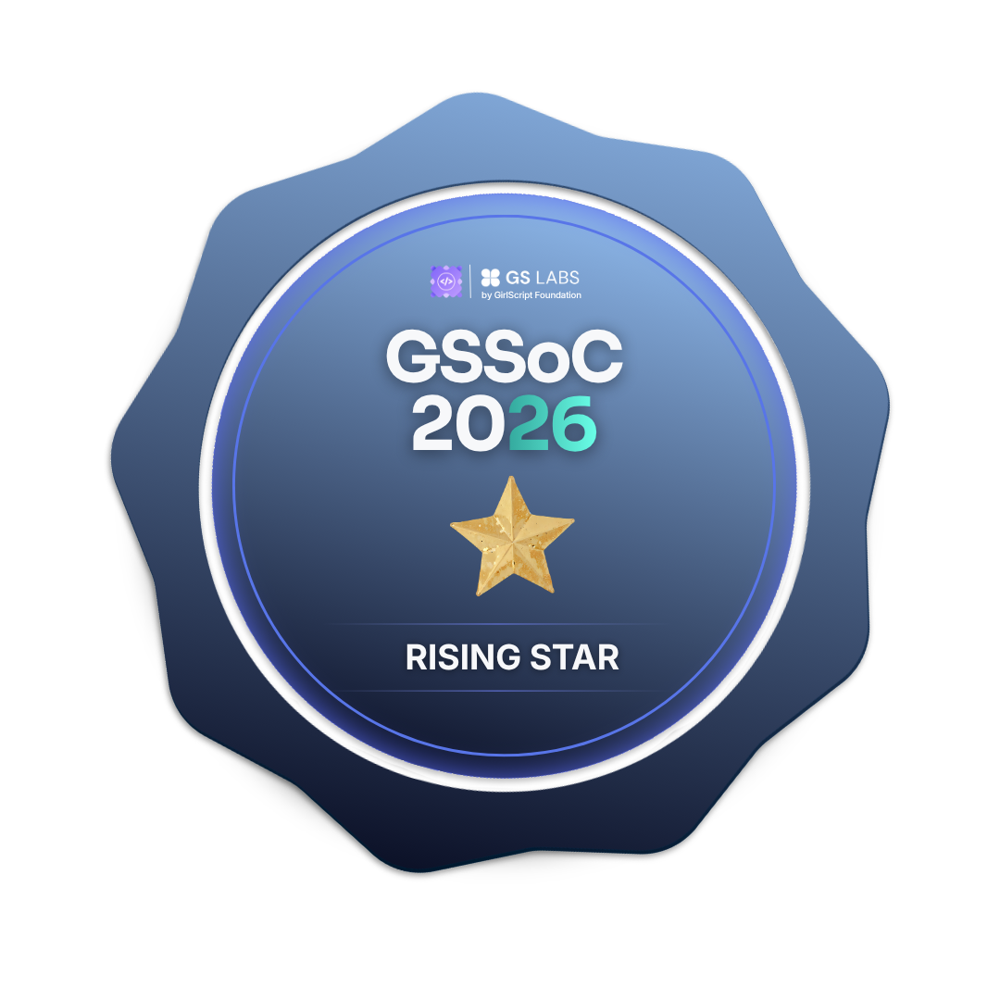

### `b.tech it` · `shipping stuff & ai things` · `figuring it out in public`

 

  

<a href="https://www.linkedin.com/in/tanushreeharika/">LINKEDIN ↗</a>
&nbsp; · &nbsp;
<a href="https://dev-portfolio-pink-eight.vercel.app">PORTFOLIO ↗</a>
&nbsp; · &nbsp;
<a href="mailto:harileet100@gmail.com">EMAIL ↗</a>
&nbsp; · &nbsp;
<a href="https://github.com/TanushreeHarika">GITHUB ↗</a>

  

<a href="#about">ABOUT</a> / 
<a href="#achievements">ACHIEVEMENTS</a> / 
<a href="#projects">PROJECTS</a> / 
<a href="#analytics">ANALYTICS</a> / 
<a href="#stack">TECH STACK</a> / 
<a href="#connect">CONNECT</a>

---

## 01 / ABOUT ME

### Building things. Learning fast. Shipping in public.

- 🚀 **Building in Public:** Engineering scalable full-stack applications & AI-powered product engines.
- 🤖 **AI-Augmented Developer:** Leveraging LLMs and intelligent workflows to rapidly scaffold, test, and ship production code.
- 🎯 **Goal:** Seeking **Software Engineering & Full-Stack Internships (2026)** to build high-impact systems.

---

## 02 / ACHIEVEMENTS

### Proof of work, not just a progress bar.

<h3>🏅 GirlScript Summer of Code (GSSoC 2026)</h3>

<table>
<tr>
<td align="center" width="33%">
<b>GLOBAL RANK</b>
<h1>#275</h1>
out of 43,587+ developers
</td>
<td align="center" width="33%">
<b>POINTS EARNED</b>
<h1>13,242</h1>
GSSoC points
</td>
<td align="center" width="33%">
<b>MERGED WORK</b>
<h1>26+ PRs</h1>
across multi-stack repositories
</td>
</tr>
</table>

 

&nbsp;

&nbsp;

&nbsp;

&nbsp;

&nbsp;

  

**📊 Official Contributor Dashboard**

---

## 03 / SELECTED BUILDS

### Things I've taken from idea to implementation.

<table width="100%">
<tr>
<td>
<h3>🐹 Hamster: Sandboxed CLI Coding Agent (Beta)</h3>
Python 3.11+ · Docker · OpenRouter API · Ripgrep · Tiktoken · PyPI
</td>
<td align="right" valign="middle">
<a href="https://github.com/TanushreeHarika/Hamster"><b>GITHUB REPO ↗</b></a>
</td>
</tr>
<tr>
<td colspan="2">
<ul>
<li>Autonomous CLI agent powered by OpenRouter LLMs with a two-stage <b>plan-then-execute engine</b>.</li>
<li>Features ripgrep file search, fuzzy diff patching, token compaction, and sandboxed Docker execution.</li>
<li>Published and installable via PyPI as <code>hamster-agent</code>.</li>
</ul>
</td>
</tr>
</table>

 

<table width="100%">
<tr>
<td>
<h3>🔍 NexMatch AI — Job Matching Platform</h3>
FastAPI · Vanilla JS · SQLite · OpenAI API · Vercel
</td>
<td align="right" valign="middle">
<a href="https://github.com/TanushreeHarika/Job-searching-AI"><b>GITHUB REPO ↗</b></a>
  
<a href="https://job-searching-ai.vercel.app"><b>LIVE DEMO ↗</b></a>
</td>
</tr>
<tr>
<td colspan="2">
<ul>
<li>AI matching engine pairing candidates to jobs automatically via multi-variable scoring.</li>
<li>Includes PDF resume parsing, automated skill gap analysis, interactive roadmaps, and dynamic score calculation.</li>
</ul>

<b>Match Engine:</b> <code>Skills (40%) + Experience (25%) + Location (20%) + Salary Fit (15%)</code>

</td>
</tr>
</table>

 

<table width="100%">
<tr>
<td>
<h3>🔐 Stealth Headless CMS for Portfolio</h3>
Next.js · React · JWT Authentication · Upstash Redis · Vercel
</td>
<td align="right" valign="middle">
<a href="https://github.com/TanushreeHarika/Dev_Portfolio"><b>GITHUB REPO ↗</b></a>
  
<a href="https://dev-portfolio-pink-eight.vercel.app"><b>LIVE SITE ↗</b></a>
</td>
</tr>
<tr>
<td colspan="2">
<ul>
<li>Embedded headless CMS with hidden admin UI unlocked via JWT middleware authentication.</li>
<li>Enables real-time dynamic CRUD operations backed by Upstash Redis without requiring re-deploys.</li>
</ul>
</td>
</tr>
</table>

---

## 04 / GITHUB TELEMETRY

### A snapshot of the work happening behind the scenes.

&nbsp;

  

&nbsp;

---

## 05 / THE TOOLKIT

### The technologies I use to turn ideas into working software.

<table width="100%">
<tr>
<td width="33%" align="center" valign="top">
<h3>01 / FRONTEND</h3>
INTERFACES & USER EXPERIENCE
  

</td>
<td width="33%" align="center" valign="top">
<h3>02 / BACKEND</h3>
APIs & DATABASES
  

</td>
<td width="33%" align="center" valign="top">
<h3>03 / TOOLING</h3>
WORKFLOW & DEPLOYMENT
  

</td>
</tr>
</table>

---

## 06 / CONTRIBUTION ACTIVITY

### Watch my commits get devoured in real time.

<!-- Generated by .github/workflows/snakes.yml -->

<picture>
<source media="(prefers-color-scheme: dark)" srcset="https://raw.githubusercontent.com/TanushreeHarika/TanushreeHarika/output/github-contribution-grid-snake-dark.svg" />
<source media="(prefers-color-scheme: light)" srcset="https://raw.githubusercontent.com/TanushreeHarika/TanushreeHarika/output/github-contribution-grid-snake.svg" />

</picture>

---

## 07 / OPEN CHANNEL

### Connect & collaborate.

**Let's build something impactful.**

Reach out for collaborations or internship opportunities!

 

&nbsp;&nbsp;&nbsp;&nbsp;

&nbsp;&nbsp;&nbsp;&nbsp;

  

| CHANNEL | ADDRESS |
|:--|:--|
| **GitHub** | [@TanushreeHarika](https://github.com/TanushreeHarika) |
| **LinkedIn** | [tanushreeharika](https://www.linkedin.com/in/tanushreeharika/) |
| **Email** | [harileet100@gmail.com](mailto:harileet100@gmail.com) |
| **Portfolio** | [dev-portfolio-pink-eight.vercel.app](https://dev-portfolio-pink-eight.vercel.app) |

 

### ✨ THANKS FOR DROPPING BY ✨

`BUILD` · `LEARN` · `SHIP` · `REPEAT`

🚀 Let's push some code that matters. If you find my projects interesting, consider leaving a star! ⭐

