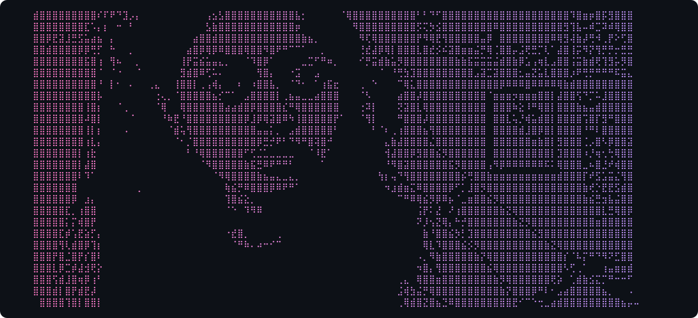
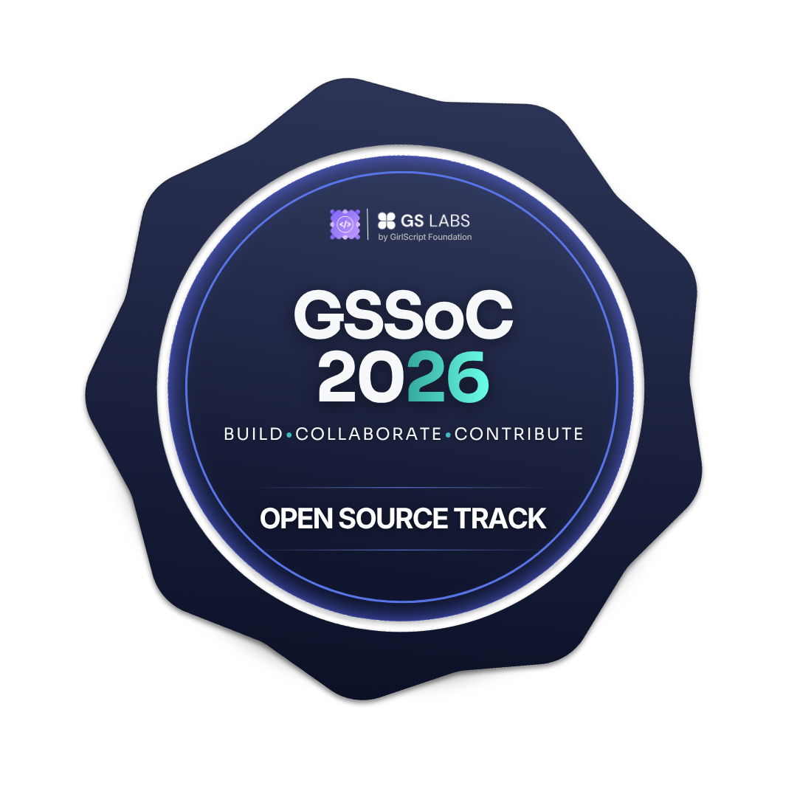
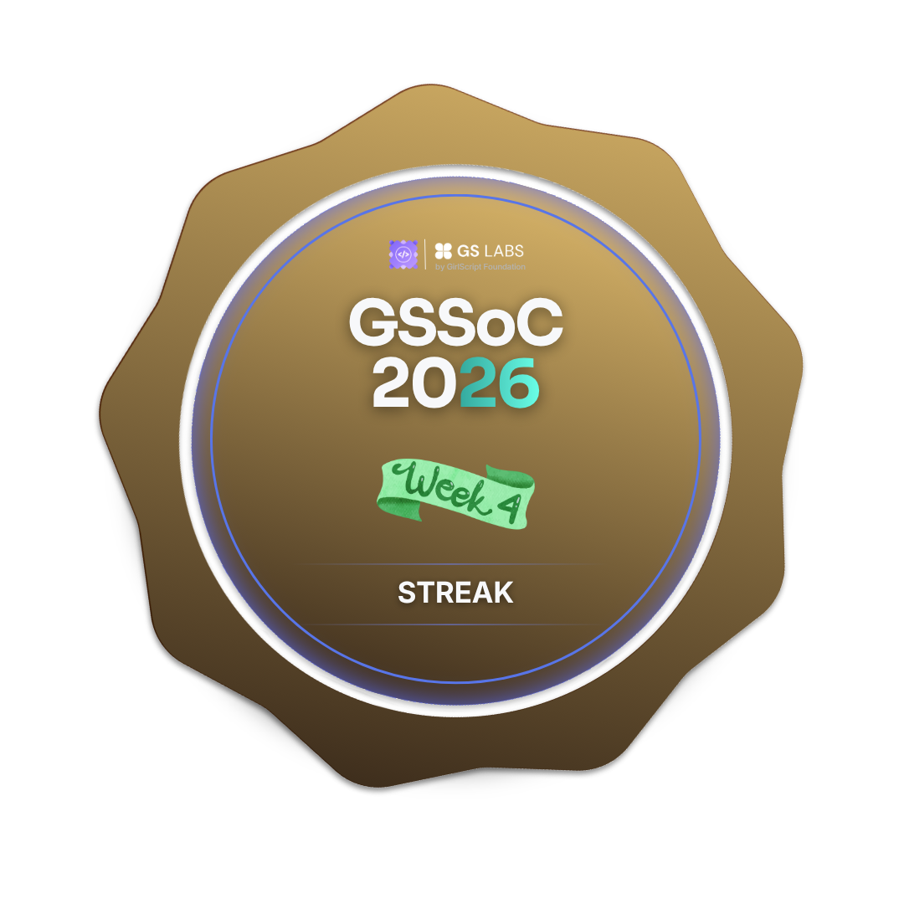
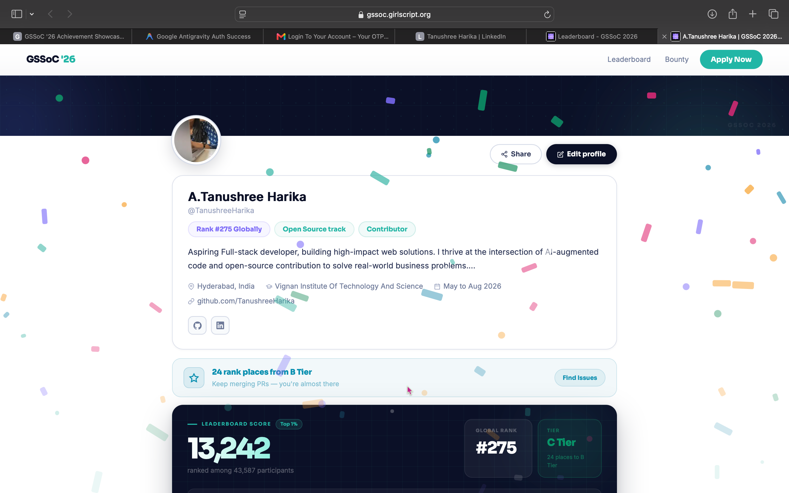

### `b.tech it` &nbsp;·&nbsp; `shipping stuff & ai things` &nbsp;·&nbsp; `figuring it out in public`

 

  

&nbsp;

&nbsp;

&nbsp;

  

<a href="#about">ABOUT</a> &nbsp; / &nbsp;
<a href="#achievements">ACHIEVEMENTS</a> &nbsp; / &nbsp;
<a href="#projects">PROJECTS</a> &nbsp; / &nbsp;
<a href="#analytics">ANALYTICS</a> &nbsp; / &nbsp;
<a href="#stack">TECH STACK</a> &nbsp; / &nbsp;
<a href="#connect">CONNECT</a>

---

## 01 / ABOUT ME
### Building things. Learning fast. Shipping in public.

I'm a B.Tech IT student interested in engineering useful software, experimenting with AI-powered workflows, and turning ideas into working products.

| SIGNAL | WHAT I'M ABOUT |
|:--|:--|
| `01` &nbsp; **BUILDING IN PUBLIC** | Engineering scalable full-stack applications and AI-powered product engines. |
| `02` &nbsp; **AI-AUGMENTED DEVELOPMENT** | Using LLMs and intelligent workflows to scaffold, test, and ship production code faster. |
| `03` &nbsp; **CURRENT GOAL** | Seeking **Software Engineering & Full-Stack Internships (2026)** to contribute to and build high-impact systems. |

> **My approach:** stay curious, build with intent, learn by shipping, and keep getting better.

---

## 02 / ACHIEVEMENTS
### Proof of work, not just a progress bar.

  

<table>
<tr>
<td align="center" width="33%">
<strong>GLOBAL RANK</strong> 
<h1>#275</h1>
out of 43,587+ developers
</td>
<td align="center" width="33%">
<strong>POINTS EARNED</strong> 
<h1>13,242</h1>
GSSoC 2026 points
</td>
<td align="center" width="33%">
<strong>MERGED WORK</strong> 
<h1>26+ PRs</h1>
across multi-stack repositories
</td>
</tr>
</table>

 

&nbsp;

&nbsp;

&nbsp;

&nbsp;

&nbsp;

  

**GSSoC 2026 · Official Contributor Dashboard**

---

## 03 / SELECTED BUILDS
### Things I've taken from idea to implementation.

<table width="100%">
<tr>
<td>
<h3>🐹 &nbsp; Hamster — Sandboxed CLI Coding Agent BETA</h3>
<b>PYTHON 3.11+</b> &nbsp;·&nbsp; DOCKER &nbsp;·&nbsp; OPENROUTER API &nbsp;·&nbsp; RIPGREP &nbsp;·&nbsp; TIKTOKEN &nbsp;·&nbsp; PyPI
</td>
<td align="right" valign="middle">

</td>
</tr>
<tr>
<td colspan="2">
An autonomous CLI agent powered by OpenRouter LLMs, built around a two-stage **plan-then-execute engine**.
<ul>
<li>Uses ripgrep for file search, fuzzy diff patching, and token compaction.</li>
<li>Runs code inside a sandboxed Docker environment.</li>
<li>Published and installable through PyPI as <code>hamster-agent</code>.</li>
</ul>
</td>
</tr>
</table>

 

<table width="100%">
<tr>
<td>
<h3>🔍 &nbsp; NexMatch AI — Job Matching Platform</h3>
<b>FASTAPI</b> &nbsp;·&nbsp; VANILLA JS &nbsp;·&nbsp; SQLITE &nbsp;·&nbsp; OPENAI API &nbsp;·&nbsp; VERCEL
</td>
<td align="right" valign="middle">

&nbsp;

</td>
</tr>
<tr>
<td colspan="2">
An AI matching engine that pairs candidates with relevant jobs through multi-variable scoring.
<ul>
<li>Parses PDF resumes and performs automated skill-gap analysis.</li>
<li>Generates interactive roadmaps and dynamically calculates match scores.</li>
</ul>
 
**MATCH ENGINE**
 
<code>Skills (40%) + Experience (25%) + Location (20%) + Salary Fit (15%)</code>
</td>
</tr>
</table>

 

<table width="100%">
<tr>
<td>
<h3>🔐 &nbsp; Stealth Headless CMS — Portfolio</h3>
<b>NEXT.JS</b> &nbsp;·&nbsp; REACT &nbsp;·&nbsp; JWT AUTHENTICATION &nbsp;·&nbsp; UPSTASH REDIS &nbsp;·&nbsp; VERCEL
</td>
<td align="right" valign="middle">

&nbsp;

</td>
</tr>
<tr>
<td colspan="2">
A headless CMS embedded into a portfolio, with a hidden admin interface protected by JWT middleware authentication.
<ul>
<li>Supports real-time dynamic CRUD operations.</li>
<li>Uses Upstash Redis as its backing store, without requiring redeployments for content updates.</li>
</ul>
</td>
</tr>
</table>

---

## 04 / GITHUB TELEMETRY
### A snapshot of the work happening behind the scenes.

&nbsp;

  

  

---

## 05 / THE TOOLKIT
### The technologies I use to turn ideas into working software.

<table width="100%">
<tr>
<td align="center" valign="top" width="33%">
<h3>01 / FRONTEND</h3>
INTERFACES & EXPERIENCE
  

</td>
<td align="center" valign="top" width="33%">
<h3>02 / BACKEND</h3>
APIs & DATA SYSTEMS
  

</td>
<td align="center" valign="top" width="33%">
<h3>03 / TOOLING</h3>
WORKFLOW & DEPLOYMENT
  

</td>
</tr>
</table>

---

## 06 / CONTRIBUTION ACTIVITY
### Watch my commits get devoured in real time.

<picture>
<source media="(prefers-color-scheme: dark)" srcset="https://raw.githubusercontent.com/TanushreeHarika/TanushreeHarika/output/github-contribution-grid-snake-dark.svg" />
<source media="(prefers-color-scheme: light)" srcset="https://raw.githubusercontent.com/TanushreeHarika/TanushreeHarika/output/github-contribution-grid-snake.svg" />

</picture>

---

## 07 / OPEN CHANNEL
### Connect & collaborate.

**Let's build something impactful.**  
Reach out for collaborations or internship opportunities.

 

&nbsp;&nbsp;&nbsp;&nbsp;

&nbsp;&nbsp;&nbsp;&nbsp;

 

| CHANNEL | ADDRESS |
|:--|:--|
| **GitHub** | [@TanushreeHarika](https://github.com/TanushreeHarika) |
| **LinkedIn** | [tanushreeharika](https://www.linkedin.com/in/tanushreeharika/) |
| **Email** | [harileet100@gmail.com](mailto:harileet100@gmail.com) |
| **Portfolio** | [dev-portfolio-pink-eight.vercel.app](https://dev-portfolio-pink-eight.vercel.app) |

 

### ✦ THANKS FOR DROPPING BY ✦

`BUILD` &nbsp;·&nbsp; `LEARN` &nbsp;·&nbsp; `SHIP` &nbsp;·&nbsp; `REPEAT`

If you find my projects interesting, consider leaving a star. ⭐

